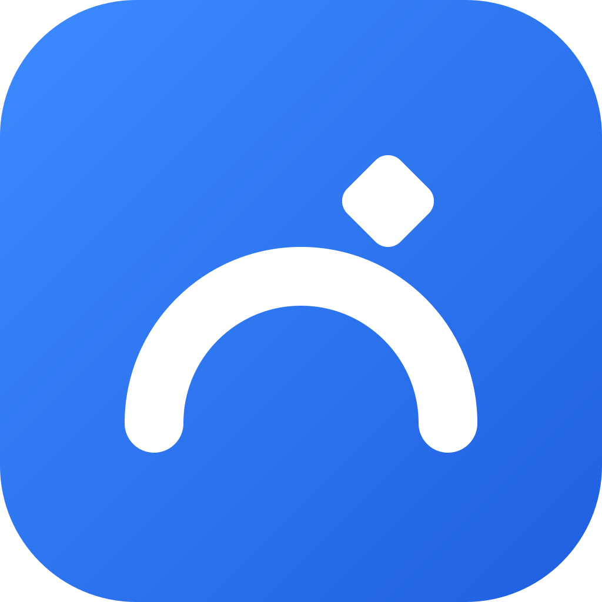

# Trasvo

Pasa fotos, videos y documentos entre tu PC con Windows y tu celular Android por tu mismo Wi-Fi. Sin cable, sin nube y sin cuenta. Gratis y de código abierto (MPL-2.0).

**Descargas y guía de instalación:** https://trasvo-app.github.io/trasvo/

- Se conectan una vez (QR, IP + código o detección automática en el Wi-Fi) y quedan enlazados en los dos sentidos.
- Quien recibe confirma antes de guardar; cada archivo se verifica con SHA-256.
- Todavía no cifra el tráfico dentro de la red, no sigue en segundo plano en Android y no hay iPhone, Mac ni Linux. Ver [Seguridad](https://trasvo-app.github.io/trasvo/seguridad.html).

## Estructura

| Carpeta | Contenido |
| --- | --- |
| `desktop/` | App de PC (Tauri: núcleo en Rust + interfaz React) |
| `mobile/` | App Android (Flutter) |
| `protocol/` | Vectores de prueba compartidos entre Rust y Dart |
| `design/` | Tokens de diseño y logo (`design/logo/`) |
| `docs/` | Arquitectura, protocolo, desarrollo y publicación |
| `web/` | Sitio (GitHub Pages, HTML/CSS sin paso de build) |
| `scripts/` | `release.ps1`: junta los instaladores y sus SHA-256 |

Lee primero [`docs/architecture.md`](docs/architecture.md) y [`docs/protocol.md`](docs/protocol.md). Para compilar y probar: [`docs/development.md`](docs/development.md). Para publicar una versión: [`docs/publicar.md`](docs/publicar.md).

## Componentes de terceros

El detalle de las licencias de las dependencias está en [THIRD_PARTY_NOTICES.md](THIRD_PARTY_NOTICES.md). El lector de QR del celular usa Google ML Kit y el instalador de Windows puede descargar WebView2 de Microsoft; ambos tienen condiciones propias y no son de código abierto.

## Licencia

[Mozilla Public License 2.0](LICENSE). El nombre y el logo de Trasvo no están cubiertos por la licencia: si distribuyes una versión modificada, usa otro nombre.
